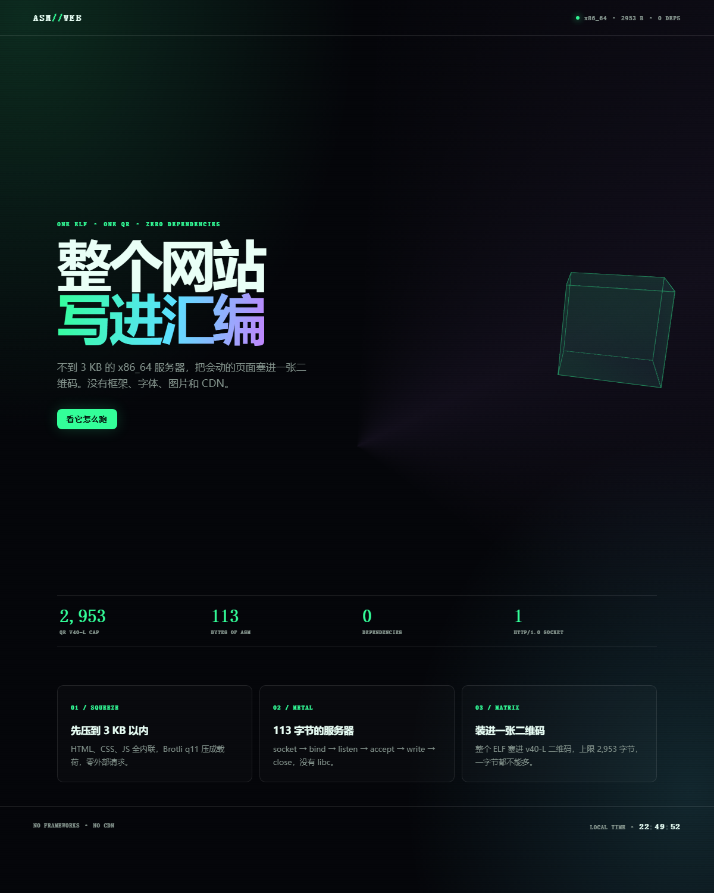
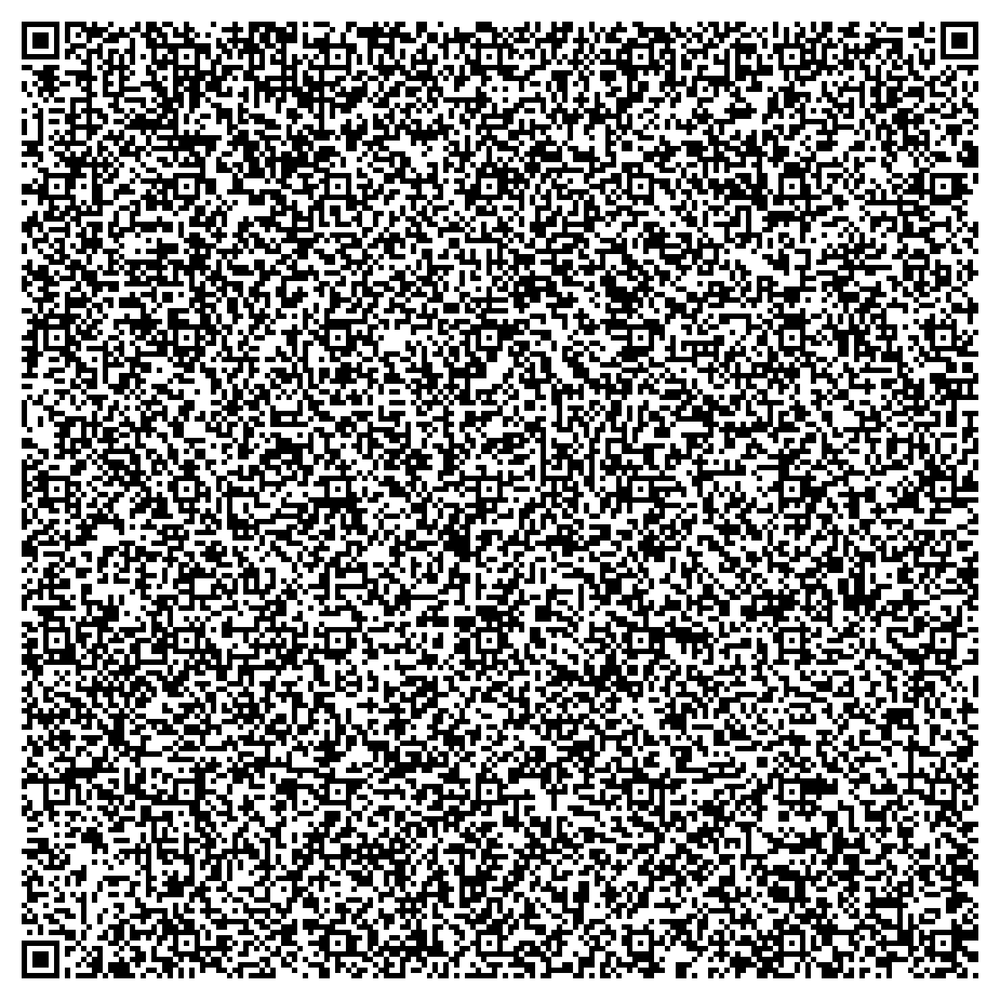
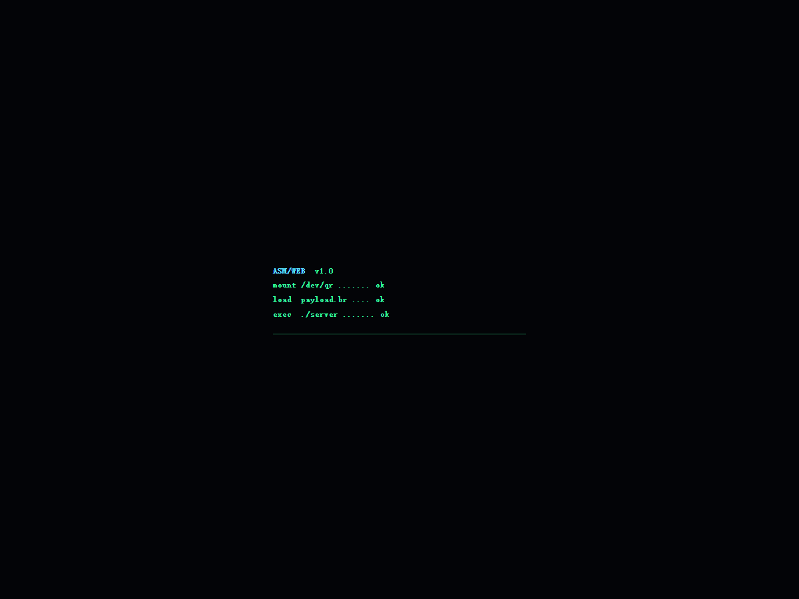
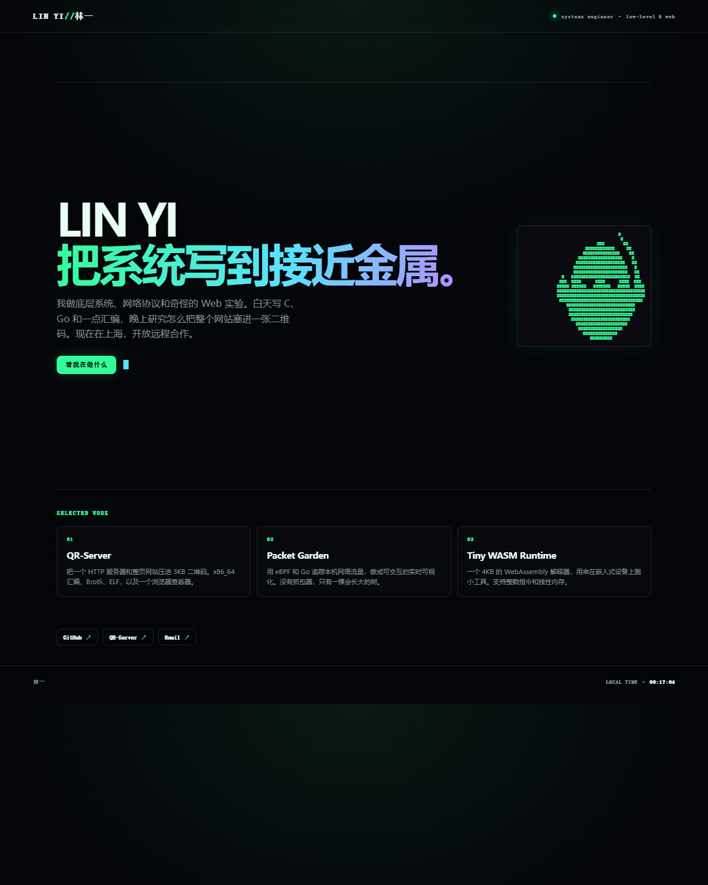
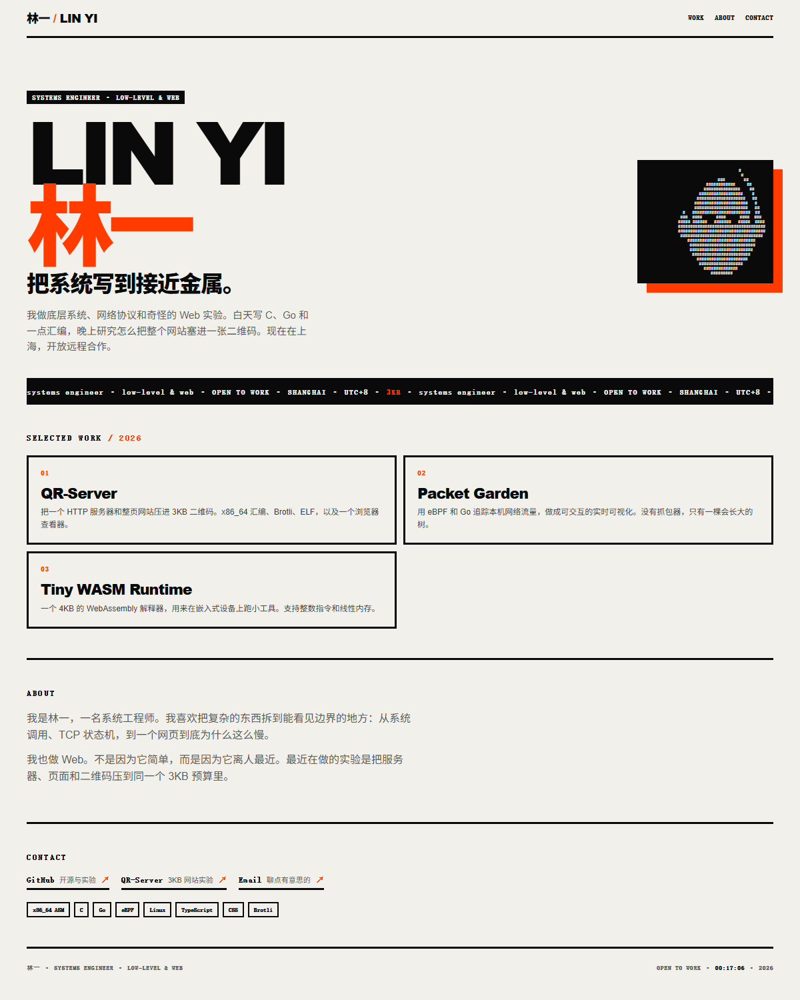
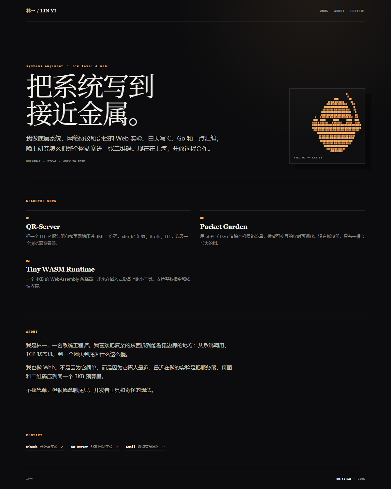
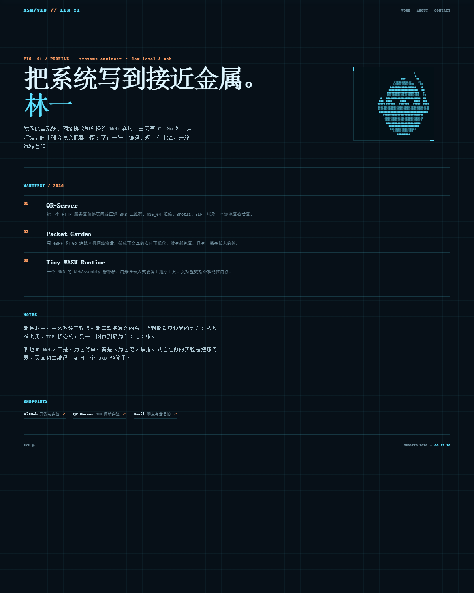
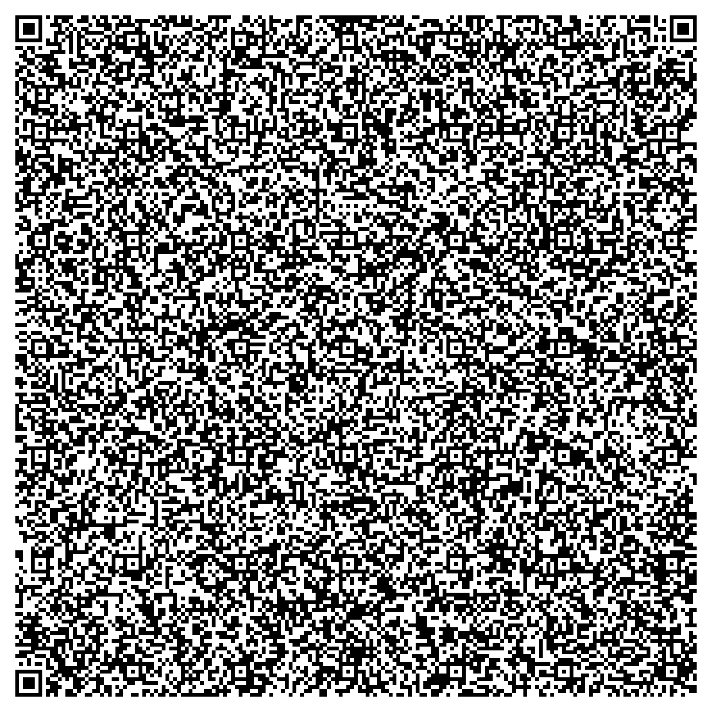
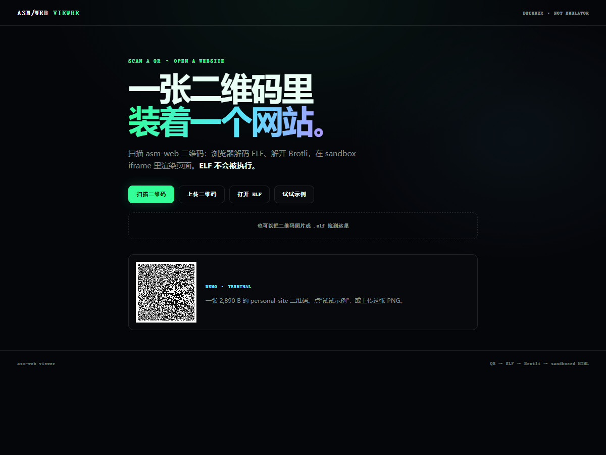
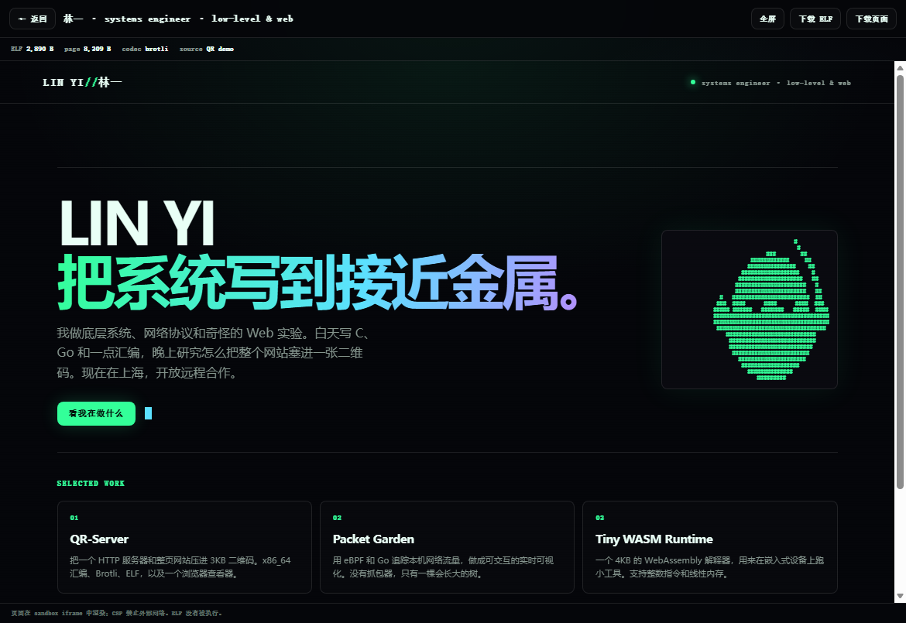

# asm-web

**A whole animated website + HTTP server inside one QR code.**

把会动的网页、113 字节的汇编服务器和一张 v40 二维码，塞进 **2,920 字节**。


[](https://github.com/SANTOSRAYYYY/asm-web/actions/workflows/test.yml)



| The QR | The boot |
| :---: | :---: |
|  |  |

## What this is

- An animated, fully self-contained page (`assets/example/index.html`): CSS gradients, a 3D cube, a glitch title, scanlines, a boot overlay, and a live clock. No images, fonts, frameworks, CDNs, or external requests.
- A **113-byte** x86_64 Linux HTTP server written in assembly. It uses syscalls only: `socket → bind → listen → accept → read → write → close`, then loops.
- The page is Brotli-compressed to **2,616 B**, embedded in a **2,920 B ELF**, and rendered as one **version 40, error-correction L QR code** (2,953 B capacity, 33 B headroom).

The trick: the server never decompresses anything. It sends `Content-Encoding: br` and the browser decompresses the body. Implementing a Brotli decoder in assembly would never fit in 3 KB.

## Personal sites

`asmweb.py personal` turns one `profile.json` into a complete personal page, generates a text portrait from a photo, and builds the same ELF/QR. The page stays self-contained: no images, fonts, or CDNs.

| terminal | brutalist |
| :---: | :---: |
|  |  |
| **editorial** | **blueprint** |
|  |  |

Static previews; the boot overlay, scanlines, marquee, glitch, scan line, and reveal animations run in the page.

| Theme | Motion | ELF | Headroom |
| --- | --- | ---: | ---: |
| `terminal` | boot overlay / scanlines / glitch / cursor | 2,890 B | 63 B |
| `brutalist` | marquee / staggered slam / hover invert | 2,879 B | 74 B |
| `editorial` | fade / rise / slow drift / underline | 2,908 B | 45 B |
| `blueprint` | scan line / clip reveal / clock | 2,833 B | 120 B |

```bash
python scripts/asmweb.py themes
python scripts/asmweb.py personal assets/example/profile.json --theme terminal -o dist/personal --emulate
python scripts/asmweb.py portrait assets/example/portrait.png --style stencil --width 64 --out portrait.html
```

The profile has name/handle/role/tagline/bio, About paragraphs, links, projects, and a portrait. Mark three projects `"featured": true`; the four themes show those three. The example profile and portrait are fictional placeholders; replace them. Use `--render-only` to measure while editing. Sitegen always minifies CSS; the HTML `--minify` flag can help or hurt, so measure both.

The portrait is generated locally as text (stencil by default; ASCII, block, and Braille are available). It is a stylized likeness, not a photo; the QR is public. Full details and intake questions: [personal-site playbook](references/personal-site-playbook.md).



The QR carries the terminal theme's ELF. Open the viewer and scan it, extract it with `asmweb.py extract --html`, or run it on Linux x86_64.

## Viewer

**https://santosrayyyy.github.io/asm-web/**

Scan the QR, upload the PNG, or open the `.elf`; the viewer decodes it in the browser and renders the page in a sandboxed iframe. **The ELF is never executed.**





- jsQR → find the HTTP response inside the ELF → brotli-dec-wasm → sandboxed iframe.
- Camera needs HTTPS (GitHub Pages) or localhost; upload and drag/drop work without a camera.
- The page runs with a CSP and without `allow-same-origin`; no external network, forms, popups, or top navigation.
- Source and build: [`viewer/`](viewer/); deploy: [`pages.yml`](.github/workflows/pages.yml); local: `cd viewer && python -m http.server 8088`.
- A normal phone camera cannot open a data QR directly. Use the viewer, `extract --html`, or the native ELF on Linux.

## Byte budget

| Part | Bytes |
| --- | ---: |
| ELF header + program header | 120 |
| `call` over the data | 5 |
| HTTP headers | 66 |
| server assembly | 113 |
| Brotli payload | 2,616 |
| **ELF total** | **2,920 / 2,953** |

The page source is 7,932 B raw, 7,807 B after conservative minify. The QR carries the ELF; the ELF carries the page.

## How it works

```
0x400000  ELF header + program header
0x400078  call -> jumps over the response data to the server
0x40007d  HTTP/1.0 headers + Brotli payload   <- r12
   ...    server code (pop r12; syscalls; loop)
```

The call's return address is the response data start, so no relocations or section headers are needed. The ELF is a single `PT_LOAD` segment mapped RWX at `0x400000`; the entry is `0x400078`.

More detail:

- [Personal-site playbook](references/personal-site-playbook.md)
- [ELF layout](references/elf-layout.md)
- [x86_64 syscalls and sockaddr](references/x86_64-linux-syscalls.md)
- [Animation and compression playbook](references/animation-playbook.md)
- [The original qr-server, measured](references/original-qr-server.md)

## Quick start

```bash
python -m pip install -r requirements.txt
python scripts/asmweb.py doctor

# Build the demo: ELF + page snapshot + QR + manifest, verified by Unicorn
python scripts/asmweb.py build assets/example/index.html -o dist --v40 --minify --emulate

# Decode the QR and inspect the ELF without running it
python scripts/asmweb.py extract dist/index.png -o dist/extracted.elf --html dist/extracted.html
python scripts/asmweb.py inspect dist/extracted.elf
```

On Linux x86_64, run the server:

```bash
chmod +x dist/index.elf
./dist/index.elf
# open http://127.0.0.1:8080
```

On Windows/macOS, use `--emulate` and the GitHub Actions workflow (Ubuntu) for native verification. The build itself works everywhere because it uses Keystone instead of nasm/ld.

## Commands

| Command | Purpose |
| --- | --- |
| `asmweb.py doctor` | Check dependencies, capacity, and supported hosts. |
| `asmweb.py size PAGE [--minify] [--codec br\|gzip]` | Compressed sizes, exact ELF size, headroom, external-reference warnings. |
| `asmweb.py build PAGE [-o DIR] [--v40] [--minify] [--emulate] [--length] [--no-drain] [--host 127.0.0.1\|0.0.0.0] [--port N]` | Build `.elf`, `.page.html`, `.png`, `.svg`, `.json`. |
| `asmweb.py personal PROFILE --theme NAME [-o DIR] [--emulate] [--render-only]` | Render a profile into a personal theme and build the ELF/QR. |
| `asmweb.py portrait IMAGE [--style stencil\|ascii\|block\|braille] [--width N] [-o OUT]` | Convert a photo/image into a text portrait and optional preview. |
| `asmweb.py themes` | List the four personal-site themes and their motion. |
| `asmweb.py extract QR [-o ELF] [--html PAGE] [--inspect]` | Decode a QR; write the ELF/page. Never executes. |
| `asmweb.py inspect ELF [--html PAGE]` | ELF header, HTTP response, page, syscall disassembly. |
| `asmweb.py emulate ELF [--page PAGE]` | Run two connections in Unicorn and verify the responses. |

If you built with `--minify`, compare emulation against `dist/index.page.html` (the exact page in the ELF), not the raw source.

## Use as a ZCode / agent skill

Clone this repository into your skills directory:

```bash
git clone https://github.com/SANTOSRAYYYY/asm-web.git ~/.agents/skills/asm-web
```

On Windows, clone into `%USERPROFILE%\.agents\skills\asm-web`. A new agent session discovers `SKILL.md`; then ask things like "把这个页面做成汇编二维码网站", "用我的 profile 做一个 personal site", or "write a 3 KB animated asm web page".

## Safety

This project produces a Linux executable inside a QR code. **Do not run an ELF from an unknown QR.** The original `qr-server` is exactly that kind of payload; running it is remote code execution.

- `extract` only writes bytes.
- `inspect` is static: ELF header, HTTP response, page, disassembly.
- `emulate` stays inside Unicorn with simulated syscalls.
- The generated server is a local demo: HTTP/1.0, no TLS, no authentication, no request parsing, no concurrency. It binds `127.0.0.1` by default; `--host 0.0.0.0` exposes it on the LAN.
- A QR is public. Do not encode secrets. A text portrait is a likeness; get consent before using someone else's face.

## Credits

Inspired by [Xelckis/qr-server](https://github.com/Xelckis/qr-server) by Michel Leonardo / Gambiarra Labs (Apache-2.0). This is an independent implementation: the example page and build code are original, the ELF layout differs, and the page is fully offline. See [references/original-qr-server.md](references/original-qr-server.md) for the measured comparison.

## License

MIT. See [LICENSE](LICENSE).
